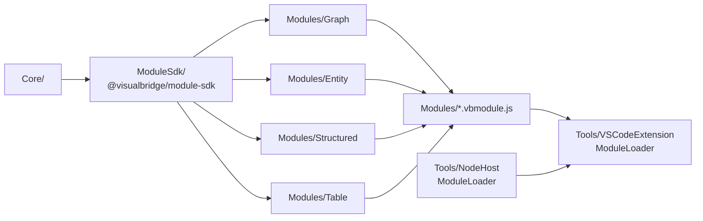

# 模块系统

## 1. 文档定位

VisualBridge 的领域能力（Graph、Entity、Structured、Table）以**领域模块**的形式交付：模块是打包成 `.vbmodule.js` 的独立 bundle，由 Project File 的 `modules[]` 声明、由宿主在受信任的本地工作区里装载。本文说明模块的开发形态、Project 声明、授权与装载、构建与 SDK 升级、故障定位与错误码，以及当前实现的边界。

模块的调试展示通过 `debug` facet 接入（见 [`DebugArchitecture.md`](DebugArchitecture.md) §5.3）；宿主的激活期接线见 [`VSCodeHost.md`](VSCodeHost.md)；Project File 由 [`ProjectCatalogManagement.md`](ProjectCatalogManagement.md) 与 Schema 定义；Unity 侧的离线 Catalog/Compile 不受模块系统影响，见 [`UnityIntegrationManual.md`](UnityIntegrationManual.md)。

## 2. 仓库布局与依赖方向



- `Core/`：与宿主无关的领域契约与公共类型；不得引用 VS Code、Webview DOM 或 Unity API。
- `ModuleSdk/`：模块作者使用的只读 SDK（`@visualbridge/module-sdk`），打包成 `.tgz` 放进 `Modules/Sdk/`；模块工程不反向依赖主仓库源码。
- `Modules/`：一个**独立的 npm root**（自己的 lockfile 与 workspaces），含四个领域包与 `Shared/Ui`、`Shared/Form`；`Modules/scripts/build.mjs` 把各领域打成 `Modules/*.vbmodule.js`。
- `Tools/NodeHost/`：`ModuleLoader`（装载、校验、facet 注册）与 Project Transaction。VS Code 扩展与 MCP 共用它。
- `Editors/`：仍留在宿主侧的编辑器代码，只有 `Editors/Ui`（`@visualbridge/editor-ui` 共享视觉层）与 `Editors/Project`（Project 文件编辑逻辑）；`Editors/Shared/` 只是保留的空占位（`.gitkeep`）；领域编辑器已随领域实现搬到 `Modules/`。

依赖方向不可破坏：`Protocol → Core → 模块 / 宿主适配器`；Unity 只消费生成的协议契约，不引用 TypeScript Core。

## 3. 模块形态

一个模块 bundle 必须导出 `manifest`、`activate` 与 `webviews`：

- `manifest`：`id`（稳定标识，必须与 Project 声明一致）、`version`、`apiVersion`（必须等于宿主的 `MODULE_API_VERSION`，当前为 1）、可选 `sdkVersion`（只用于诊断）、`editors`（该模块提供的 editor id 列表）。
- `activate(host)`：返回 `ModuleRegistration`，宿主在装载时调用一次。`host.log(level, message)` 写入宿主 Output；模块不得阻塞、不得假设自己会被重复激活。
- `webviews`：`{ [key]: { script, style } }`，由 `buildModule` 从源码打包并注入虚拟模块——入口里的 `webviews` 导出**不会被读取**。

`ModuleRegistration` 的形状（SDK 与 Core 共用同一份类型）：

| 成员 | 必填 | 语义 |
| --- | --- | --- |
| `editors[]` | 是，至少一项 | 每个 `EditorRegistration` 声明一个 editor id |
| `validateOptions(options)` | 否 | 校验 Project `modules[i].options`，返回 `DocumentDiagnostic[]`；诊断定位到 `modules[i].options` |
| `dispose()` | 否 | 工程关闭或模块卸载时释放资源 |

`EditorRegistration` 的 facet（宿主按需取用，缺省即该能力不可用）：

| facet | 语义 |
| --- | --- |
| `editor` | 稳定 editor id，被 Project 的 `documentTypes[].editor` 引用 |
| `semantic` | 必填；`DocumentFacet`（解析、序列化、Operation、校验） |
| `catalog` | Catalog 解析与绑定 |
| `create` | 新建文档（`prepare` + `createDocument`） |
| `session` | 打开文档时构造会话控制器（工厂，不在 `activate` 期建会话） |
| `webview` / `webviewTitle` | 必填；对应 bundle `webviews` 的 key 与标题 |
| `reveal` | 把引用位置翻译成 Webview 定位消息（消息类型由模块登记） |
| `references` / `referenceData` | 引用种类与文档侧数据 |
| `mcp` | MCP 工具侧的文档语义 |
| `operationSchema` | Operation JSON Schema，由 `visualbridge_project` 返回 |
| `debug` | 调试展示 facet（分类、窗口标题、`onRecord`） |

装载器会做四类跨模块冲突校验：editor id 重复（`module.editorConflict`）、reference kind 重复（`module.referenceKindConflict`）、debug 分类重复（同样报 `module.editorConflict`）、以及 registration 形状非法（`module.registrationInvalid`）。冲突时**先成功声明者保留**，后声明者被停用并回退只读，不静默覆盖。

## 4. Project 声明

Project File 的 `modules` 是必填数组，每项声明稳定 `id`、`.vbmodule.js` 入口、可选 `options` 与可选 `hash`：

| 字段 | 约束 |
| --- | --- |
| `id` | 稳定标识；必须与 bundle `manifest.id` 一致 |
| `entry` | 规范化 Project 相对路径，以 `/` 分隔、以 `.vbmodule.js` 结尾；不得越出 Project Root、不得经过符号链接或大小写别名 |
| `options` | 可选 JSON 对象；形状由模块的 `validateOptions` 校验，宿主不理解其业务含义 |
| `hash` | 可选 `sha256:<小写 hex>`；声明后与 bundle 实际字节比对，不符即停用 |

`documentTypes[].editor` 只是稳定 Adapter ID。未注册的 ID 仍是合法声明：宿主用通用只读 Document Shell 显示 Project、Document Type、Adapter ID、路径与源码，不提供领域编辑、Catalog 语义、Reference 或 Lifecycle。模块未加载（`untrusted` / `failed` / `disabled` / `stale`）时，其 editor 也回退到只读 Shell，并给出原因。

内置四域的 Project 声明与 bundle 产物在 `Modules/`；模块 `options` 的领域含义（例如 Table 的 `tableLayout`）由各模块自己的文档说明。

## 5. 授权与装载

这是**执行模块代码**的边界，不是沙箱：

1. **授权判据唯一**：`resolveModuleAuthorization` 要求 Workspace Trust **且** Project Root 是本地 `file` scheme；否则全部模块为 `untrusted`，不装载、不求值、不注册 facet。`VB_SKIP_MODULES=1` 走 `skipped`（工作区已信任但进程刻意跳过，便于排查），宿主与注册源必须调用**同一个**判据函数。
2. **Restricted Mode 零执行**：未信任工作区里不装载任何模块；此时领域文档以只读 Shell 打开，Project File 的模块诊断说明原因。宿主与注册源各写一份判据会造成 Remote-SSH/devcontainer 下的越权，代码注释与测试都锁住这一点。
3. **装载顺序**：路径规范化与别名检查 → 读字节并计算 SHA-256 → `vm.compileFunction` → manifest 校验 → `activate` → registration / options / editor 冲突校验。任一步失败只影响该模块，其它编辑器不受影响。
4. **状态**：`loaded`、`failed`、`untrusted`、`disabled`、`stale`。`hashMismatch` 与 `apiVersionMismatch` 归 `disabled`（文件被动过或契约版本不符，宿主拒绝执行），其余装载错误归 `failed`；`stale` 表示模块文件在已装载后发生变化、需要重新装载，宿主先标记再重建。

## 6. 构建与 SDK 升级

```powershell
npm run build:modules      # npm ci --prefix Modules && npm run build --prefix Modules
npm run prepare:modules    # 确保 Modules/*.vbmodule.js 存在（门禁与宿主都依赖）
npm run build:bundles      # 重新打包所有领域 bundle
npm run check:targets      # 校验 bundle 与源码一致（drift 即失败）
npm run build:sdk          # 生成并更新 Modules/Sdk/*.tgz
npm run check:sdk          # 校验 SDK tgz 与声明一致
```

- `build:sdk` 用仓库自带的确定性打包器（最小 ustar writer + gzip stored 块，**不使用 `npm pack`**）产出 `.tgz`，字节只由仓库内容决定，因此 `check:sdk` 的字节基线**跨 Node/npm/zlib 版本稳定**；`check:sdk` 重新打包后与已提交的 `Modules/Sdk/*.tgz` 逐字节比较。
- SDK 升级：模块 manifest 的 `apiVersion` 必须等于宿主 `MODULE_API_VERSION`（当前 1）。不匹配会被 `module.apiVersionMismatch` 停用（`disabled`）；`sdkVersion` 只产生 warning 诊断、不参与门禁。
- 模块工程只依赖 `Modules/Sdk/*.tgz` 与自己的构建依赖（React、React Flow 等由 `buildModule` 打进 bundle/Webview IIFE）；**bundle 运行期**只允许 `require` Node 内置模块，打包产物必须可求值、manifest 合法。

## 7. 故障定位

模块问题有两条可观察通道：

1. **Output 通道 `VisualBridge`**：宿主写入 `[modules] ...` 日志（工程装载、信任变化、模块准备失败、关闭与释放、重复 Create 等）；模块自己的 `host.log()` 也进这里。排障顺序建议：先看 Output，再看 Project File 上的诊断。
2. **Problems**：模块诊断合并进 Project File 的 `visualbridge-project` 诊断集合，定位到 `modules[i]` 或 `modules[i].entry` / `.hash` / `.options` / `.editors[j].editor`。一条模块失败不会阻断其它模块，也不会阻断只读 Shell。

常见症状与判据：

| 症状 | 先查什么 |
| --- | --- |
| 打开文档只显示只读 Shell，提示需要信任工作区 | Workspace Trust 是否授予、Project Root 是否本地 `file` scheme；`VB_SKIP_MODULES` 是否被设置 |
| Project File 上 `modules[i].entry` 报错 | `entry` 是否存在、是否 `.vbmodule.js`、是否经过符号链接/大小写别名、是否越出 Project Root |
| `modules[i].hash` 报 `module.hashMismatch` | 声明 hash 与实际字节是否一致；重新构建 bundle 后是否忘了更新声明 |
| 模块状态是 `stale` | 模块文件在装载后被改动；重新装载（或重开窗口）后确认是否仍为 `stale` |
| `modules[i].options` 报 `module.optionsInvalid` | 模块自己的 `validateOptions` 诊断，按 `path`（如 `$.debug`）定位 |
| 两个模块抢同一个 editor / 分类 | 先声明者保留，后者报 `module.editorConflict` / `module.referenceKindConflict`；Project 里只能保留一个 owner |
| `activate()` 抛错 | Output 里的 `module.activateFailed` 堆栈；模块装配期不应依赖文档或网络 |

错误码全集（除 `sdkVersionMismatch` 外都是错误诊断，`hashMismatch` / `apiVersionMismatch` 额外把模块置为 `disabled`）：

| 码 | 触发 |
| --- | --- |
| `module.invalidPath` | `entry` 不是规范化相对路径、不以 `.vbmodule.js` 结尾、越出 Project Root 或不是普通文件 |
| `module.entryAlias` | `entry` 经符号链接、junction 或大小写别名解析到别的路径 |
| `module.notFound` | `entry` 或其路径段不存在 / 不可读 |
| `module.hashMismatch` | 声明 hash 格式非法，或与 bundle 实际 SHA-256 不符（置 `disabled`） |
| `module.loadFailed` | bundle 不可求值、`require` 了非 Node 内置模块、装载器已释放 |
| `module.manifestInvalid` | bundle 未导出对象，或 manifest 的 `id` / `version` / `apiVersion` / `editors` / `webviews` 形状非法 |
| `module.idMismatch` | Project `modules[].id` 非法或重复，或与 bundle `manifest.id` 不一致 |
| `module.apiVersionMismatch` | `manifest.apiVersion` 不等于 `MODULE_API_VERSION`（置 `disabled`） |
| `module.activateFailed` | `activate()` 抛错 |
| `module.registrationInvalid` | registration 不是对象、`editors` 为空、facet 形状非法或 `webview` key 未命中 |
| `module.editorConflict` | editor id 或 debug 分类已被另一个模块声明 |
| `module.referenceKindConflict` | reference kind 已被另一个模块声明 |
| `module.optionsInvalid` | Project `modules[].options` 不是 JSON 对象，或模块 `validateOptions` 返回错误 |
| `module.untrusted` | 未授予 Workspace Trust，或 Project Root 不是本地 `file` scheme |
| `module.disabled` | 宿主停用该模块（hash / API 版本不符，或 `VB_SKIP_MODULES=1`） |
| `module.callFailed` | 调用模块 facet（如 `validateOptions`）抛错或返回非法值 |
| `module.sdkVersionMismatch` | 仅 warning：bundle 声明的 `sdkVersion` 与宿主 SDK 不一致，不阻断装载 |

## 8. 已知限制与边界

本节条目都是模块平台的**既定边界**（归属：模块平台设计本身，不是待办任务）；每条给出边界、原因与用户可见后果。模块级故障的定位与错误码见 §7。

1. **模块不做沙箱**：模块在扩展宿主进程内执行，与宿主同特权；`require` 只放行 Node 内置模块是**打包约定**，不是安全边界（`process`、`global`、动态 `import()` 仍按 Node 语义可用）。宿主不把原始字节交给模块是接口约定，不是隔离。只能装载已经审查的工程模块。
2. **`Editors/Ui` 与 `Modules/Shared/Ui` 的源码逐字节相同，但包清单与 tsconfig 不同**：`index.ts`、`src/**`、`test/**` 共 10 个文件逐字节一致；`package.json`、`tsconfig.json`、`tsconfig.test.json` 因两套 root 而不同——`Modules/Shared/Ui` 的 tsconfig extends `@visualbridge/module-sdk/tsconfig/webview.json`，`package.json` 额外声明 `@visualbridge/module-sdk` 的 `file:../../Sdk/*.tgz` 依赖与 `@types/node`/`@types/react-dom`，测试 tsconfig 改为 extends 自身；`Editors/Ui` 的 tsconfig extends 主仓库的 `tsconfig.editor.base.json`。原因是 `Modules/` 是独立 npm root，不能反向依赖主仓库。`Modules/Shared/Form` 是模块侧独有（`Editors/Form` 已在 G2a 删除，无宿主副本）。`Modules/Shared/Ui` 的**源码**必须与 `Editors/Ui` 同步修改，当前没有门禁自动比对字节。
3. **模块信任与文档只读是两件事**：Restricted Mode 下模块零执行、文档只读；授予 Trust 后模块重新装载，但**已打开的只读 Shell 不会自动升级**为领域编辑器，需要重新打开文档。
4. **editor 归属按状态优先级**：同一 editor 被多个**已加载**模块声明时，loader 把后声明者判 `disabled` 并报 `module.editorConflict`，同一 editor 只有一个可用 owner；宿主组装归属时**已加载模块优先**于 failed/disabled/untrusted 的同名声明，因此先声明但失败的模块不会遮蔽后面真正可用的模块，失败的那一方回退只读 Shell 并给出原因。
5. **模块 options 的校验归模块**：宿主只保证它是 JSON 对象并转发给 `validateOptions`；没有 `validateOptions` 的模块，`options` 写错不会报错，只会在运行期表现为默认行为。
6. **SDK tgz 的 `src` 不自包含**：打包的源码含指向主仓库 `Protocol/Generated/contracts` 的相对路径；把 SDK 装到仓库外只做类型检查时，需要同时提供该目录或改用声明产物。
7. **不做模块市场、签名与远程下载，也不做热替换**：模块只能由 Project File 声明、从工作区内的 `.vbmodule.js` 装载，信任判据是 Workspace Trust（VS Code）与 `VISUALBRIDGE_MODULES_ENABLED` + 路径边界（MCP），没有签名校验、没有远程分发；bundle 改动只能重新装载（先标 `stale`），没有运行期热替换；跨 `apiVersion` 也不做兼容（§6）。原因：第一版只解决"可拆、可加载"，多一套分发与签名会连带引入新的信任模型。后果：换模块版本必须改 Project 声明并重新加载工程。归属：模块平台设计边界，不是待办。
