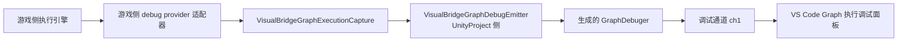

# Unity Graph 执行过程调试接入指南

## 1. 文档定位与链路

本文是**游戏侧引擎**接入 VisualBridge Graph 执行观察链路的操作指南：如何把引擎的图执行事件转发到采集门面、如何生成并调用调试契约，以及稳定 ID 映射规则。



链路要点：

- **只观察、不做断点**：执行引擎归游戏侧，VisualBridge 不实现节点调度、求值或暂停。
- 采集门面只负责“收集事实”，**数据出口只有一个**：注入的观察者（`IVisualBridgeGraphExecutionObserver`）。G1b 已删除旧的 Runtime Bridge `graphExecution` 订阅通道；现在事件经统一调试契约（`category = "graph"`）走 **ch1**，由 VS Code 的 Graph 模块 `debug` facet 消费。
- 调试契约、消息格式、宿主消费层与录制回看边界见 [`DebugArchitecture.md`](DebugArchitecture.md)；Unity Package 与 Runtime Bridge 的其余部分见 [`UnityIntegrationArchitectureRuntime.md`](UnityIntegrationArchitectureRuntime.md)。

## 2. 前置条件：稳定 ID 映射

- `.vbflow` 图文档是唯一创作源。Graph 编译产物（`Library/VisualBridge/Compiled`，Play 模式经 Runtime ArtifactStore 加载）中每个节点携带 VisualBridge 文档的**稳定节点 ID**。
- 游戏侧导入器（把编译产物转成游戏执行数据）**必须**把该稳定 ID 带入运行时数据的节点 UID 表（等价于 FlowGraph 参考实现的 `NodeUIDs`：`NodeID → NodeUID` 映射，注释即“用于调试器显示”）。
- 转发事件时，节点参数一律使用稳定节点 ID（即 UID 表中的 UID），**不得**使用节点列表下标等重排后会漂移的临时 ID；否则 VS Code 页面无法点亮对应节点。
- 执行实例身份由 VisualBridge 分配（`exec-<n>`），游戏侧不自造执行 ID 体系；游戏侧自己的执行者标识（哪个角色在跑，如参考实现的 `debugKey`）作为 `debugKey` 原样上报。

## 3. 采集门面 API

`VisualBridge.Runtime.VisualBridgeGraphExecutionCapture`（静态类，线程安全，无 Unity API 依赖；[`VisualBridgeGraphExecutionCapture.cs`](../Packages/com.kyle.visualbridge/Runtime/Bridge/VisualBridgeGraphExecutionCapture.cs)）：

| 方法 | 语义 |
| --- | --- |
| `OnInstanceStarted(documentTypeId, documentId, graphName, debugKey, out executionId)` | 执行实例开始。返回 `false` 表示未在追踪（Runtime Bridge 服务端未运行），调用方应忽略后续事件。 |
| `OnInstanceStopped(executionId)` | 实例停止；实例从注册表移除，观察者收到停止事实。 |
| `OnNodeStart(executionId, nodeStableId, frameIndex)` | 节点开始执行。 |
| `OnNodeOutput(executionId, nodeStableId, outputIndex, frameIndex)` | 节点输出端口触发。 |
| `OnDataNode(executionId, nodeStableId, frameIndex)` | 数据节点执行。 |
| `OnEdgeValueChanged(executionId, nodeStableId, outputIndex, value, frameIndex)` | 数据边值变化；`value` 为引擎侧字符串化结果（上限 4096 字符，超长自行截断）。 |
| `IsTracking` | 服务端是否在追踪（诊断用）。 |
| `SetObserver(observer)` | 宿主装配：注入/移除观察者；注册时若已有运行中实例，会按 `executionId` 顺序补发一次实例开始事实。 |

开销语义：**没有观察者时全部节点级方法走零分配快速路径直接返回**；只有实例起止（低频）在无观察者时仍登记注册表。每条事件携带引擎 `frameIndex`（逐条携带，VS Code 侧支持事件级/帧级回放步进）。

观察者由宿主注入：Play 模式下 `VisualBridgeGraphDebugEmitter` 在 `BeforeSceneLoad` 自动挂接；EditMode 用例可显式 `Install()`。采集与传输解耦——Runtime 程序集不引用调试程序集。

## 4. 调试契约与生成

调试接口声明在工程侧（不是 Package 里），因为生成的 writer 必须和调用它的代码在同一个程序集：

- 契约：[`UnityProject/Assets/VisualBridgeGraphDebug/IGraphDebuger.cs`](../UnityProject/Assets/VisualBridgeGraphDebug/IGraphDebuger.cs)，六个方法 `InstanceStarted` / `NodeStarted` / `NodeOutput` / `DataNode` / `EdgeValueChanged` / `InstanceStopped`，标 `[VisualBridgeDebuger("graph", Kind = Event)]`。
- 生成入口：菜单 **Tools / VisualBridge / Generate Debug Contracts** 与 **Check Debug Contracts**，或 batchmode `-executeMethod VisualBridge.Editor.VisualBridgeDebugGeneratorBatch.Generate` / `.Check`（退出码 `0` 成功、`1` 执行失败、`2` Check 发现 drift）。
- 产物：`UnityProject/Assets/VisualBridgeGenerated/Debug/debug-contracts.json`（契约清单）与 `UnityProject/Assets/VisualBridgeGraphDebug/Generated/` 下的 writer（`GraphDebuger` 等）；`graph.g.ts` 是 TypeScript 声明，**当前没有消费者**，但 `Check` 仍把它纳入 drift 校验。
- emitter：[`VisualBridgeGraphDebugEmitter.cs`](../UnityProject/Assets/VisualBridgeGraphDebug/VisualBridgeGraphDebugEmitter.cs) 把采集事实转成契约事件，并在每条事实前做幂等 `Create` 复核（`isInstanceRegistered`），会话复位后自动补建、重连后恢复上报。

实践要点：

- 每个执行实例在一个会话里只 `Create` 一次，`InstanceStopped` 时 `Finish` 一次；`Finish` 同时注销活跃登记，不能跳过。
- `Create` 早于连接时只入待发队列（无连接时不入数据队列），此时不要发 `InstanceStarted`（必被丢弃并计 dropped）；连接建立后的第一条事实会补发。
- `Start → PushParam → End` 必须同线程连续调用；emitter 用一把发送锁串行化整条生成调用，游戏侧不要绕过它直接拼消息。

## 5. 适配器示例

以参考实现（ActionEditor FlowGraph）的 provider 模式为例：引擎侧已有 `IFlowDebugerProvider` 风格的插桩缝时，写一个小适配器把事件转发到门面，引擎本体与 VisualBridge 互不引用：

```csharp
using VisualBridge.Runtime;

// 游戏侧实现：注册为引擎的 debug provider。
public sealed class VisualBridgeFlowDebugProvider : IFlowDebugerProvider
{
    public FlowRuntimeDebuger Create(string scriptName, string key)
    {
        // documentTypeId/documentId 来自游戏侧导入器加载的图文档身份。
        return VisualBridgeGraphExecutionCapture.OnInstanceStarted(
            DocumentTypeId, DocumentId, scriptName, key, out var executionId)
            ? new VisualBridgeFlowDebuger(executionId)
            : null;
    }

    public void OnStop(FlowRuntimeDebuger debuger) { /* 见下 */ }
}

public sealed class VisualBridgeFlowDebuger : FlowRuntimeDebuger
{
    private readonly string executionId;
    public VisualBridgeFlowDebuger(string executionId) { this.executionId = executionId; }

    protected override void OnNodeData(FlowDebugNodeData data)
    {
        switch (data.Type)
        {
            case FlowDebugNodeType.Execute:
                VisualBridgeGraphExecutionCapture.OnNodeStart(executionId, ResolveNodeUid(data.NodeID), data.FrameIndex);
                break;
            case FlowDebugNodeType.Output:
                VisualBridgeGraphExecutionCapture.OnNodeOutput(executionId, ResolveNodeUid(data.NodeID), data.OutputIndex, data.FrameIndex);
                break;
            case FlowDebugNodeType.ExecuteDataNode:
                VisualBridgeGraphExecutionCapture.OnDataNode(executionId, ResolveNodeUid(data.NodeID), data.FrameIndex);
                break;
            case FlowDebugNodeType.OutputValue:
                VisualBridgeGraphExecutionCapture.OnEdgeValueChanged(
                    executionId, ResolveNodeUid((int)(data.EdgeID >> 32)), (int)(data.EdgeID & uint.MaxValue), data.OutputValue, data.FrameIndex);
                break;
        }
    }
}
```

要点：

- `ResolveNodeUid` 是游戏侧 UID 表反查（运行时 NodeID → VisualBridge 稳定节点 ID），映射表由导入器在加载时建立。
- 实例停止转发 `OnInstanceStopped(executionId)`（引擎 `Stop()` / provider `OnStop` 处）。
- 事件上报的时机与粒度由引擎插桩点决定；VisualBridge 只做透传，不改写顺序。

## 6. 事件如何到达面板

- emitter 把事实写成 `category = "graph"` 的契约事件（`InstanceStarted` / `NodeStarted` / `NodeOutput` / `DataNode` / `EdgeValueChanged` / `InstanceStopped`），走调试通道 ch1。
- VS Code 宿主解码后按 `(category, instanceId)` 建实例、入 store；Graph 模块的 `graphDebugFacet` 把记录映射成时间轴增量（契约方法名归一成界面事件种类），并把 `InstanceStarted`/`InstanceStopped` 里的 `documentId` 作为文档投递提示。
- 面板的「执行调试」入口订阅的是 **facet 数据面**，不再向 Runtime Bridge 发 `subscribeGraphExecution`。打开面板时的再水化只恢复本地记录；实时数据随调试通道到达。
- 编辑模式（未进入 Play）不产生调试数据：Editor 桥连接不安装调试传输，`Create` 直接返回 `false`，面板在线实例为空是正常现象（见 [`DebugArchitecture.md`](DebugArchitecture.md) §8.8）。

## 7. 验证与已知边界

- 采集门面与发射端有 EditMode 覆盖：实例生命周期、无观察者快速路径、幂等 `Create`、会话复位后的自愈、`Finish` 与登记注销。
- 待发缓冲/记录上限与回放语义由宿主调试数据面负责（见 [`DebugArchitecture.md`](DebugArchitecture.md)）：每分类最多 64 个关键帧、实例数上限 32、每实例记录上限 20000。
- 事件经 ch1 传输，因此继承调试通道的全部边界：连接栈不做多播、重连后 `InstanceStarted` 不重发、静默换代清空登记（见 [`DebugArchitecture.md`](DebugArchitecture.md) §8）。面板在重连后可能需要应用重新注册才能恢复实例。
- `ScriptableObject` 排除条款与单一权威源原则对本链路同样适用：执行观察不写回任何 Authoring 数据。
