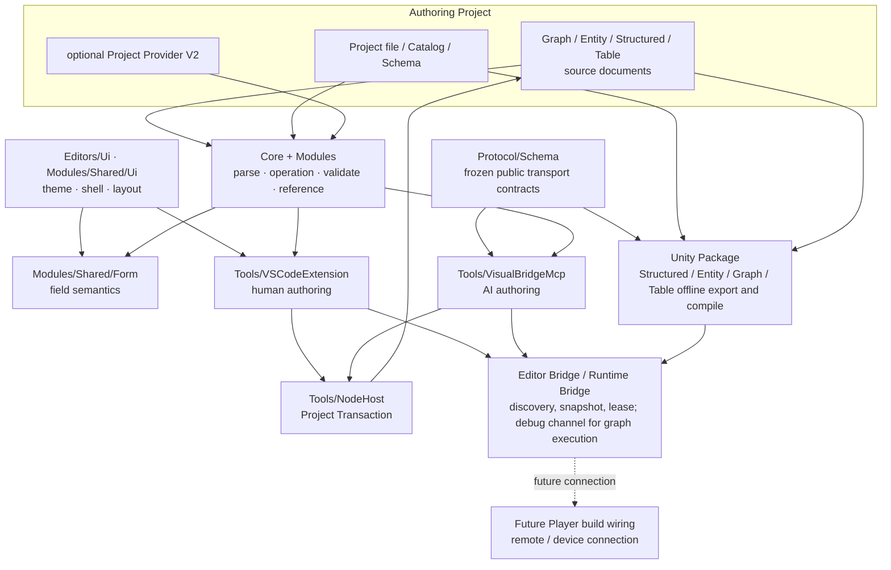
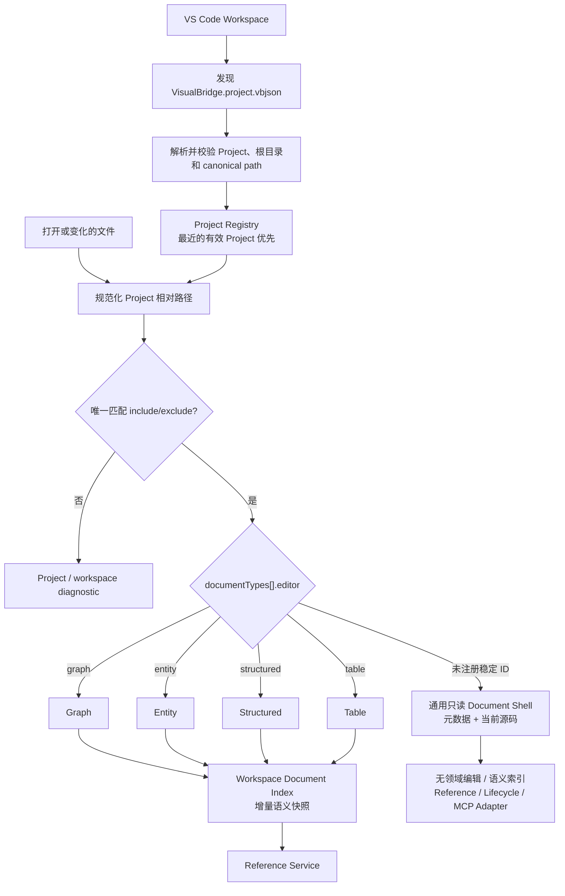
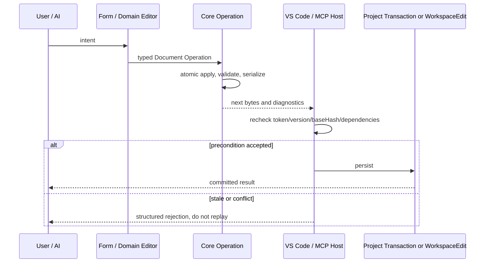

# VisualBridge 架构：核心领域模型与事务

本文是 [VisualBridge 架构设计](VisualBridgeArchitecture.md) 的子文档，覆盖产品定位、核心原则、总体架构、Authoring Project、Document System、Catalog 与 Reference System。

## 文档定位

本文描述 VisualBridge，一个基于 VS Code 的游戏语义内容创作平台。平台用于承载游戏逻辑、游戏流程、结构化属性、数据引用和运行时调试等不依赖模型与实时渲染的编辑工作，并通过 Unity Bridge 与 Unity Editor 和 Player 协作。

本文是当前 VisualBridge 单仓库的架构基线，主要确定：

- Authoring Project、Document、当前扩展入口和未来 Runtime 的边界。
- VS Code 基础插件、项目扩展、Unity Bridge 和 MCP 的职责。
- 编辑数据、描述文件、生成数据和运行时数据的所有权。
- Unity/Player 通信、实例发现和多客户端调试尚待设计时必须遵守的边界。
- 平台仓库的现状和游戏工程的建议目录结构。
- 分阶段开发路径。

本文不约束具体游戏项目。当前已实现的 JSON Schema、协议、编辑器和 Host 行为以 `Protocol/Schema`、源码及对应正式文档为准；Editor Bridge 与 Runtime Bridge 的字段以 `visualbridge-editor-bridge.schema.json` 与 `visualbridge-runtime-bridge.schema.json` 为权威，本文的概念图不得被用来臆造字段。仍待设计的边界（Unity Player 产物接线、远程/设备连接）继续在各自实施阶段单独冻结。

## 产品定位

平台定位为“游戏语义内容创作工具”，不试图重新实现 Unity Editor。

适合迁移到 VisualBridge 的工作：

- 游戏逻辑图。
- 游戏流程、状态机和规则编排。
- 行为树、任务、对话和关卡流程。
- 属性配置和结构化数据。
- 表格型配置。
- 跨文档和游戏数据引用。
- 批量查找、校验、重构和格式迁移。
- 节点与流程级的执行过程观察（只观察、不做断点；断点式调试不迁移）。
- AI 读取、生成和修改游戏内容。

继续保留在 Unity 的工作：

- Scene 和 Prefab 空间编辑。
- 模型、材质、Shader、贴图和渲染预览。
- 强依赖 SceneView、Gizmo 和 GameObject 的编辑器。
- 动画、Timeline 和需要实时画面反馈的内容。
- Unity 原生资产导入与平台构建。

两侧通过 Catalog、稳定引用和调试协议协作，而不是互相加载对方的 UI 或内部对象。

## 设计目标

### 核心目标

- 用一个通用 VS Code 基础插件承载多种游戏语义文档。
- Authoring Project 能同时包含编辑文件、描述文件、项目扩展和工具入口。
- VisualBridge 原生文档采用适合 Git、代码评审和 AI 修改的文本格式；`.xlsx` 和 `.csv` 等 Table Document 载体通过 Codec 与 MCP 访问。
- C#、游戏配置或外部数据能够生成编辑器所需的 Catalog 和引用描述。
- 项目业务扩展不需要修改基础插件。
- VS Code 和 MCP 使用同一套核心编辑与校验能力。
- Unity Editor 已通过独立设计的上层检查契约接入（Editor Bridge + Runtime Bridge）；Player 接入时继续沿用同一契约，不另建第二套语义。
- 多个 VS Code 窗口、AI Agent 和 Unity 实例接入时能够明确路由和协调：不使用全局“当前 Unity”，实例按发现记录显式选择，写入受单控制者租约约束。
- 平台先通过少量垂直切片验证，再逐步扩展文档类型。

### 非目标

- 当前 Authoring 基线不实现多人实时协同编辑。
- 当前 Authoring 基线不支持 VS Code Web、Codespaces 和 Remote SSH。
- 当前 Authoring 基线不提供任意业务代码的安全沙箱。
- 当前 Authoring 基线不替代 Unity 的场景和资源编辑器。
- 当前 Authoring 基线不建立中心化云服务。
- 本文不重复各领域正式文档已经冻结的字段。Editor Bridge 与 Runtime Bridge 的消息、发现记录与错误码已由各自 Schema 和 [`UnityIntegrationArchitecture.md`](UnityIntegrationArchitecture.md) 冻结；仍待设计的远程/设备传输与 Player 产物接线不在本文预先冻结。

## 核心原则

### 源文件是唯一权威数据

Authoring 文档是游戏语义内容的源数据。Unity 导入资产、运行时数组、索引、缓存和调试状态都是派生数据。

```text
Authoring Source Documents
    -> 校验与编译
    -> Unity Editor 数据
    -> Runtime 数据
```

VS Code Webview 只是源文件的可视化视图，不能维护第二份权威文档状态。所有编辑最终通过 Document Operation 作用于当前 Document Type 声明的权威文件载体。

### 描述与实例分离

Catalog 和 Schema 描述“可以编辑什么”；Authoring Document 描述“项目实际创建了什么”。

```text
类型、节点、端口、属性、引用规则
    -> Catalog / Schema

节点实例、属性值、连接、流程
    -> Authoring Document
```

Catalog 可以由 Unity C#、外部配置或项目扩展生成。Document 不复制能够从 Catalog 推导的内容。

### 稳定身份与显示信息分离

当前 Project、Document、Document Type、Element、Reference 和 Graph 连接都使用稳定 ID。文件名、路径、显示名称和 C# 类型名允许变化，不能直接承担永久身份。未来 Runtime Instance 若需要跨进程寻址，必须另行定义稳定身份及其与 Authoring ID 的映射；当前协议没有 Runtime Instance ID。

### 平台机制与业务语义分离

当前基础插件提供工程发现、文档编辑、Catalog、引用、诊断、事务和 MCP Authoring 机制。技能、道具、战斗节点、任务规则等业务语义由 Catalog 和已授权 Project Provider 提供；与 Unity 的通信由本机回环的 Editor Bridge（Unity 请求 VS Code 打开/定位文档）与 Runtime Bridge（实例发现、文档快照、Source 映射、Graph 执行观察）承担，调试语义限于只读检查，不做断点。

### 声明优先，代码扩展兜底

属性、类型、菜单、引用和常见校验优先通过 JSON 声明表达。只有动态查询、复杂校验和特殊 UI 才使用可执行扩展。

### AI 与人工使用同一核心

VS Code 和 MCP 都依赖 VisualBridgeCore 与领域模块（`Modules/`），不分别实现 Parser、Catalog、Operation、Validator、Reference 或 Serializer。普通 VS Code 文本文档编辑使用 TextDocument / WorkspaceEdit 以保留 Undo/Redo；VS Code Lifecycle、Reference Refactor、Table 多来源保存与所有 MCP 写入通过 `Tools/NodeHost` 共用可恢复 Project Transaction。完整锁、Hash、journal 和恢复契约见 [`ProjectTransaction.md`](ProjectTransaction.md)。

## 总体架构



当前实线部分已经在单仓库中落地。Unity Package 已消费同源生成的 C# wire/data bags，并通过 strict `JObject` validator 完成 Profile、Project、Structured / Entity / Graph 三域 Catalog Export 与 Structured / Entity / Graph / Table 四域离线 Compile；Editor Bridge（Unity 请求 VS Code 打开/定位文档）与本机 Runtime Bridge（实例发现、文档快照、调试租约、Source 映射、Graph 执行观察）也已落地，两条通道都不跨网络边界（Runtime Bridge 只监听 `127.0.0.1`，Editor Bridge 的 TCP 端点同样只绑定 `127.0.0.1`、并以 Windows 命名管道为回退）。虚线仍表示尚未实现的边界：Unity Player 构建的产物接线与远程/设备连接（含 WebSocket）。各项冻结决策与实施记录见 [`UnityIntegrationArchitecture.md`](UnityIntegrationArchitecture.md) 与历史任务记录 [`Archive/UnityDomainAndRuntimeRoadmap.md`](Archive/UnityDomainAndRuntimeRoadmap.md)；当前未实现能力见 [`Backlog.md`](Backlog.md)。

## Authoring Project

### 工程概念

Authoring Project 是平台自己的工程边界，与 Unity Project 和 VS Code Workspace 是不同概念：

- Unity Integration Profile V1 固定为每个 Unity Project 关联一个位于该 Unity Project 内的 Authoring Project；VS Code Registry 仍只根据工作区中的 Project File 建立边界，不读取 Unity 工程状态。未来多 Project 关联需要先升级 Profile contract。
- 一个 VS Code 窗口可以加载多个 Authoring Project。
- 一个 Authoring Project 可以声明多个 Project 相对文档根目录。
- VS Code 使用的 Project File 可以位于本地工作区内任意工程目录；Unity slice 通过独立的 `ProjectSettings/VisualBridgeIntegration.json` 指向 Unity Project 内的 Project File，不向 Project File v2 增加 Unity 字段。

可编辑根目录由固定的 `VisualBridge.project.vbjson` 标识。该文件使用 VisualBridge 专属文件名和 `.vbjson` 后缀，内容为 JSON。VS Code 插件只有在工作区中发现并成功解析该文件后，才启用 VisualBridge 工程功能。

### 当前可运行工程结构

```text
AuthoringRoot/
├─ VisualBridge.project.vbjson
├─ Catalog/
│  ├─ Gameplay.vbgraphcatalog
│  ├─ Gameplay.vbentitycatalog
│  ├─ Gameplay.vbstructuredcatalog
│  └─ Gameplay.vbtablecatalog
├─ Logic/
├─ Entities/
├─ Config/
├─ Tables/
└─ Providers/
   └─ optional-provider.mjs
```

目录职责：

- `VisualBridge.project.vbjson`：当前唯一的工程边界与插件启用标识。
- `Catalog`：Project File 显式引用的四类外部描述文件；目录名可以自定义。
- `Logic`、`Entities`、`Config` 和 `Tables`：示例中的 Authoring 源目录；实际名称和后缀完全由 `documentRoots` 与 `include` / `exclude` 决定。
- `Providers`：可选的已构建 Project Provider V2 `.mjs` 入口；只有 Project 声明且宿主授权后运行。

维护中的通用 Authoring 结构见 [`Samples/PreUnityAuthoring`](../Samples/PreUnityAuthoring/README.md)；Unity 固定样例位于 `UnityProject/VisualBridgeAuthoring`。四域 Compiler 只在 `UnityProject/Library/VisualBridge/Compiled` 创建可删除派生数据，不创建 `.visualbridge/generated`、`.visualbridge/cache` 或 `Library/VisualBridge/Discovery`。Bridge discovery 记录不写入 Authoring Project，而是各自写入系统临时目录：Editor Bridge 用 `visualbridge-bridge/<windowId>.json`（VS Code 侧按窗口发布），Runtime Bridge 用 `visualbridge-runtime/*.json`（Unity 实例自写）。

### VisualBridge Project File 职责

VisualBridge Project File 当前声明：

- `projectId` 和 `formatVersion`。
- `documentRoots` 与每个 Document Type 的 `include` / `exclude`。
- Document Type 的稳定 `id`、可扩展稳定 `editor` Adapter ID 和 Catalog 路径。
- `modules` 模块声明及其自有 `options`（Table 行布局位于 `visualbridge.table` 的 `options.tableLayout`）。
- 可选 Project Provider V2 的入口、参数和能力上限。

当前 Schema 不包含项目 Webview Manifest、Unity Profile、生成范围或工具版本字段。未来需要这些能力时必须先扩展正式 Schema、Core Parser、Project Settings 和 Host 验证，不能把未登记键写进 Project File。

VisualBridge Project File 不保存编辑器窗口状态、连接端口、当前调试会话和其他临时信息。

当前路由核心由 `formatVersion`、`projectId`、`documentRoots`、`modules` 和 `documentTypes` 构成，并可带 `providers`。`modules` 从 v2 起必填，声明要装载的模块 bundle 与其自有 `options`；`formatVersion: 1` 会被拒收且不自动升级。每个 Document Type 至少声明稳定 `id`、可扩展稳定 Adapter ID `editor`、包含规则 `include`，并可声明排除规则 `exclude` 和工程相对 `catalogs` 数组。Schema 与 Core 接受任意合法稳定 `editor` ID；当前注册并提供完整语义的值为 `graph`、`entity`、`structured` 和 `table`。未注册 ID 仍可被 Project Registry 唯一匹配，VS Code 只为其打开显示元数据和当前源码的通用只读 Document Shell，不建立领域编辑、Catalog 语义、语义索引、Reference 或 Lifecycle；MCP Project 读取/清单保留该声明并报告 `adapterAvailable: false`，其他依赖领域 Adapter 的语义操作不可用。`id` 表示项目在该 Adapter 下扩展的业务子类；文件扩展名完全由 `include` / `exclude` 决定，不参与 Adapter 判断。同一个实际文件必须只匹配一个 Document Type，业务子类不得依赖声明顺序解决 Glob 重叠。路径和 Glob 统一使用 `/` 分隔，所有文档根目录和 Catalog 必须位于 Project File 所在目录内。

### 工程发现和索引

插件首先在当前 VS Code Workspace 中发现 VisualBridge Project File。只有发现并成功解析该文件的工程才创建 ProjectContext。打开 Authoring 文件时，再从当前文件目录向上寻找最近的 VisualBridge Project File，以确定文件归属。



工程索引只使用已注册 Adapter 的既有 Parser、Catalog Registry、Validator 和 Reference Collector，不为未注册稳定 ID 建立简化或猜测语义。当前 VS Code Host 在激活时建立四个内置 Adapter 的文档基线，随后按 Project、Document Type、Catalog 依赖和逻辑物理来源增量复用不可变语义单元；Reference Service 消费同一 Project Snapshot。刷新支持事件合并、取消、进度与陈旧 generation 丢弃，增量与强制完整重建必须产生相同稳定排序、诊断和引用结果。完整契约见 [`WorkspaceIndexPerformance.md`](WorkspaceIndexPerformance.md)。

项目级重构同样建立在语义索引和 Reference Provider 之上。当前支持唯一解析的 `document`、`entity.component`、`graph.element` 和 `table.row`：Core 生成按完整目标位置匹配的确定性影响计划，各 Document Type 通过正式语义变换、Validator 和 Serializer 生成修改，VS Code 与 MCP Host 使用源哈希、临时载体和 rollback 副本提交多文件事务。不得退化为跨工程文本替换。完整约束见 [`ProjectRefactoring.md`](ProjectRefactoring.md)。

Document Lifecycle 负责创建、复制、物理路径移动和安全删除。它与稳定 ID 重构共享索引、Reference Provider 和 Project Transaction，但路径不承担身份：Path Move 保持字节与稳定 ID 不变，Stable ID Rename 继续走 Project Refactoring。V1 只允许一个宿主无关 Lifecycle Service，并要求 strict preview/apply、调用方完整提交 `stableIdRemap`、Delete closure 和 Reference coverage；VS Code、Browser 与 MCP 不分别实现文件操作规则。完整契约见 [`DocumentLifecycle.md`](DocumentLifecycle.md)。

## Document System

### Document Type

平台以 Document Type 作为核心扩展点。当前每种内置文档类型提供：

```text
DocumentType
├─ TypeId 与文件匹配规则
├─ Schema 与版本
├─ Parser / Serializer
├─ Editor 类型
├─ Edit Operations
├─ Validators
├─ Reference Rules
└─ Lifecycle Adapter / Stable ID Remap / Delete Closure
```

当前 Unity Exporter/Compiler 不属于 VS Code Document Type Adapter 注册契约；它们依据冻结的 Profile、Project、Catalog/Document 与显式 C# metadata 独立运行。Unity 侧也不提供 Authoring 到 Unity 资产的 Debug Mapping 注册面：Runtime Bridge 的文档级 Source 映射（`getDocumentSources` 返回 `sourcePath` 与 `sourceSha256`）是唯一落地的映射契约，漂移由 VS Code / MCP 侧对照工作区字节计算。

当前平台支持：

- Graph Document：逻辑图、状态机、游戏流程。
- Entity Document：Entity 根配置与可组合 Component 列表。
- Structured Document：属性、对象和集合配置。
- Table Document：表格型配置。

对话、任务、行为树和时间轴等文档在核心稳定后增加。

### Graph Document V3 与 Graph Catalog V4

当前落地的 Graph Document 使用 `.vbgraph` JSON 文本格式，并通过 Graph Catalog 提供语义规则：

- 顶层包含 `formatVersion`、`documentId`、`rootGraphId` 和平铺的 `graphs` 集合。
- 每个 Graph 自身包含稳定 ID、显示名称、JSON 属性和公开接口；右侧 Graph Inspector 只编辑当前 Graph，并可折叠到画布侧边。
- 一个文件拥有根图及其内嵌子图；子图节点以稳定 `subgraphId` 独占另一个 Graph，包含关系不得递归成环。
- Node、Node Type、Port、Property、Graph 和 Graph Interface 均使用独立于显示名称与实现类名的稳定 ID。
- Edge 显式区分 `flow` 与 `data`。流程边决定执行顺序并允许环路；数据边只传值，不决定执行顺序。
- Graph Document Type 可以加载多个 Graph Catalog。Registry 记录每个节点类型的所属 Catalog，并统一解析 Graph Type、节点类型、跨 Catalog Data Type 和旧类型 alias。
- Graph Catalog V4 定义节点类型、端口方向、连接种类、数据类型及其可选显示颜色、连接数量、属性、默认值和旧类型别名。未配置颜色时编辑器按 Data Type ID 从内置色板稳定取色；颜色只影响字段、数据端口与数据连线的呈现。Graph Type 以 `supportedCatalogIds` 粗筛节点 Catalog，再以可选 `allowedNodeSelectors` 精筛节点。
- C# 数值语义在 Data Type ID 中保持为独立的 `int` 与 `float`，不得合并成 `number`。属性的 `valueType: "number"` 仅描述 JSON 数值形态和编辑控件；Unity Catalog Exporter 将 `System.Int32`/`System.Single` 分别映射到 `int`/`float`。
- `List<T>` 字段由带稳定元素 ID 的数据动态组承载，并以 `listPortMode` 在“整个 List 一个输入端口”和“每个元素一个输入端口”之间二选一。元素顺序变化不改变连线身份；整个 List 连接时覆盖完整字面列表，元素连接时只覆盖对应元素。
- `portConnectionRules` 定义 Graph Type 输入/输出端口的 `single` 或 `multiple` 规则；端口 `maxConnections` 只能进一步收紧。跨 Catalog 数据连接继续遵守同一套全局 Data Type 兼容规则。
- 编辑器向有效但已占用的单连接端口创建新连线时，在同一批 Operation 中先删除旧连线再添加新连线；多连接端口达到上限后仍拒绝连接，不自动猜测应替换哪一条。
- 子图通过稳定公开接口与父图连接；跨图连接不能绕过接口直接指向内部节点。子图输入/输出接口节点可创建稳定 ID 的动态数据参数；其类型由子图内部或父图外部首次具体连接锁定，只要任一侧仍有连接就保持，全部断开后恢复 `any`。动态参数在子图接口节点和父图调用节点中始终显示，未锁定的 `any` 状态使用浅灰色。
- Graph Webview 使用 React 与 React Flow 的受控模式实现画布交互；React Flow 状态仅作为视图状态，不作为文档格式或权威数据源。
- Parser 拒绝未知结构，Serializer 对 Graph、节点、连线和属性键进行确定性排序；接口数组保留用户拖动后的声明顺序。找不到 Catalog 节点类型时仍保留全部原始节点数据。
- Core Operation 覆盖 Graph、节点、内嵌子图、公开接口、连线、安全节点类型替换和稳定元素 ID 重命名；`graph.renameElement` 会同步修正所有结构与连接端点。

节点标题与 Catalog 字段直接在画布节点上编辑，节点类型只展示不可直接改写。用户通过节点右键菜单请求替换，Core 仅接受不会丢失属性或连线的候选，并以一个 Operation 完成替换。完整落地契约见 [`GraphSemanticModel.md`](GraphSemanticModel.md)。当前实现范围仍只包含离线编辑，不连接 Unity。

### Entity Document V1 与共享字段模型

当前落地的 Entity Document 保存 Entity 根属性和有序 Component 实例。Entity Catalog V1 声明 Component Group、Entity Type、允许的 Group、Component Type、菜单路径、来源追踪和字段定义；同一 Document Type 可以加载多个 Catalog，并以全局无歧义的稳定 ID / alias 建立 Registry。

Entity 的组织方式借鉴旧配置编辑器的 Entity、分组和 Component 卡片概念，但 Authoring JSON 直接替代 `ScriptableObject` 编辑数据，不迁移 `ScriptableObject`、子资源、包装配置或 Export 按钮。正式游戏项目只保留运行时真正使用的普通 C# class / struct。

字段能力位于 Core 与共享 Form Editor，而不是 Entity 私有实现。数值、颜色、选择项、引用、List 和非框架普通自定义结构体都通过递归字段定义表达；`valueType` 描述 JSON 形态，`dataTypeId` 保留 `int`、`float` 和游戏结构等运行时语义。Graph、Structured、Table 与后续编辑器应复用这套字段解析、校验和 UI 原语。字段 List 的布局与交互同样属于共享 Form Editor：元素操作区统一放置 dnd-kit 拖拽手柄、在后添加和删除图标，排序结束后以一次字段提交进入宿主 Document Operation。Entity Component、Table Record 与 Graph 稳定端口列表也必须沿用“拖拽、在后添加、删除”的图标顺序和紧邻操作组；它们仍分别提交自己的 Operation，不把领域身份或连接规则下沉到 Form Editor。

Entity Document 的默认便利后缀是 `.vbentity`，但业务文件可以使用 Project File 声明的任意扩展名。完整格式、Operation、编辑器行为和未来 Unity 生成约束见 [`EntityComponentModel.md`](EntityComponentModel.md)。

### Structured Config V1

当前落地的 Structured Config 保存一个普通 C# class / struct 对应的单根配置对象。Project File 的 `editor: "structured"` 只选择编辑器大类；Document Type 的稳定 `id` 直接解析到 Structured Catalog Registry 中一个 Config Type 的规范 ID 或 alias，`include` / `exclude` 负责自定义文件扩展名。类型绑定只有 Project Document Type 一个权威来源，Structured 文件不重复保存 `configTypeId`。

Structured Catalog V1 声明 Config Type、来源追踪和共享 Field Definition。文件只包含 `formatVersion`、稳定 `documentId` 和完整 `properties`，不保存标题、路径或 C# 类型名。创建时递归物化全部默认字段；编辑器复用共享 Form/Reference 原语，修改以 `structured.setField` 批次进入 Core；MCP 复用同一语义，并与 Graph、Entity、Table 和 Refactor 共用 `baseHash` 检查与可恢复 Project Transaction。

当前不提供旧格式兼容或迁移层。Unity Structured offline slice 已实现 Catalog Export 与 Editor 派生编译，但不提供 Runtime loader/行为、Debug、DAP、Player 或 `ScriptableObject` 工作流。Authoring 契约见 [`StructuredConfigModel.md`](StructuredConfigModel.md)，Unity 边界见 [`UnityIntegrationArchitecture.md`](UnityIntegrationArchitecture.md)。

### Table 与 Excel

Table Document 是平台的通用表格语义模型。Excel 是它支持的一种文件载体和交换格式，不单独形成一套与 Document System 平行的编辑体系。

```text
Table Document
├─ Semantic Table Model
├─ Schema / Column Rules
├─ Table Operations
├─ Validation / Reference
├─ Table Editor Webview
└─ Codec
   ├─ Authoring Text Codec
   └─ Excel Workbook Codec
```

工程必须明确每类表格的数据所有权：

- Authoring Text 为权威数据，Excel 只用于导入和导出；这是面向 Git、AI 和多人协作的默认建议。
- `.xlsx` 为权威数据，由 Excel Workbook Codec 统一解析和写回；适用于必须延续现有 Excel 工作流的工程。

无论采用哪种所有权，UI、MCP 和 Unity Compiler 都面向 Semantic Table Model 与 Table Operations，不直接操作工作簿内部二进制结构。工程描述文件和 Provider 可以扩展列类型、枚举、数据引用、Unity 资产引用、校验、预览和跳转能力。

AI 不直接读取或改写 `.xlsx` 和 `.csv` 载体。即使 `.csv` 在物理上是文本，对 AI 也视为 Table Document 载体；AI 必须通过 MCP 提供的表格查询、搜索和修改能力访问 Semantic Table Model。MCP 内部统一使用 Table Codec 和 Table Operations，避免 AI 绕过 Schema、引用和校验规则。

当前 Table V1 只承诺受约束的游戏数据工作簿。宏、图表、透视表、外部链接、复杂公式和完整样式往返保真不在通用 Table Editor 的承诺范围内。

当前 Table V1 已落地 Table Catalog、CSV/XLSX Codec、Table Operation、记录式主从编辑器与固定样例。Project File 统一配置一基的 `nameKeyRow` 和 `dataStartRow`；C# 导出的 Catalog 负责列稳定 ID、类型、共享字段编辑器、单元格编码，以及由稳定 Column ID 占位符组成的 `rowDisplayNamePattern`（例如 `{id}_{name}`）。一个逻辑 Sheet 可以通过 `{part}` 命名模板映射到多个同结构 CSV 文件或 XLSX Worksheet，并按稳定列 ID 执行 `error`、`keepFirst` 或 `keepLast` 去重策略。物理源不因去重而丢失，编译和查询使用策略解析后的有效行。完整契约见 [`TableSemanticModel.md`](TableSemanticModel.md)。

### 编辑事务

所有编辑通过领域操作完成：



编辑事务至少具备：

- `baseHash` 或等价版本前置条件。
- 批量操作和全部成功/全部失败语义。
- 稳定 ID 生成。
- 完整文档校验。
- 确定性格式化。
- 结构化诊断和变更摘要。

DocumentSession 保存当前编辑基线的 Hash。VS Code 在实际写入前再次检查目标文件；如果目标文件自基线建立后已被其他窗口、AI、MCP 或外部程序修改，不自动合并或静默覆盖，而是向用户提供：

- 覆盖：使用当前 DocumentSession 内容覆盖磁盘上的外部变更。
- 放弃并刷新：放弃当前未写入变更，重新读取目标文件并刷新编辑窗口。

用户未做出选择时不执行写入。MCP 遇到同类 `baseHash` 冲突时返回结构化冲突结果，不自动覆盖。

VS Code 的文本 Document 通过 `WorkspaceEdit` 保留 Undo/Redo。`.xlsx` 等二进制 Document 通过 Custom Document 的编辑事件、保存和备份机制与 VS Code 协作。MCP 采用原子文件写入。两者使用同一 Operation 模型，但按文件载体使用不同的宿主持久化适配。

共享字段的 UI 提交粒度见 [`FormFieldEditor.md`](FormFieldEditor.md)，VS Code 的 TextDocument、Table CustomDocument、Webview token/epoch 和诊断所有权见 [`VSCodeHost.md`](VSCodeHost.md)。

### Document Lifecycle V1

Lifecycle 不属于普通 Document Operation：它会改变物理 source manifest、创建新身份或删除可被 Reference Provider 寻址的目标，因此必须先 preview、后 apply。调用方在 preview operation 中完整提供 Copy `stableIdRemap` 或 Create `parameters`；preview 返回 `previewHash`、`planPayload` 和包含 dependencies/baseHashes/mutations 的规范 plan。Apply 原样带回 operation、hash、payload、bases 和 dependencies，并在 Project 锁内重建相同计划。任何变化都以 conflict 结束，不自动套用旧计划。

V1 只允许同一 Project、同一 Project Document Type 内操作。Graph/Entity/Structured 的 Path Move 保持单文件字节不变；Table 的 CSV family 以完整分表 manifest 为一个逻辑 Document，XLSX 以整个 Workbook 为单位。Copy 由领域 Adapter 显式 remap 全部可寻址内部身份；Delete 在 Reference coverage 不完整或闭包外存在入站 occurrence 时拒绝，不提供通用级联。

元素级删除（Component、Graph Node/Interface/Dynamic Port、Table Row）是普通单文件 Operation，不受 Safe Delete guard 约束；同文档悬空引用被原子拒绝，跨文档悬空引用由持有方文档的 Reference 校验兜底。整文档级操作与显式元素 Lifecycle Delete 仍由领域编辑器、Document Browser 与目标 MCP 入口调用同一 Lifecycle Service。目标 Project Transaction 将 physical mutation 表达为 `replace`、`create`、`delete` 或 `move`，同时校验 `baseHash` 与 mutation 的 `targetMustBeAbsent`。

Lifecycle preview/apply 要求 Project 中没有未保存的 VisualBridge TextDocument 或 Table CustomDocument；干净的已打开 Table Editor 不会单独阻止 Lifecycle。Explorer、Git 和外部脚本不是协作写者，只能依靠文件监听、Hash/absence 复核和重新索引检测；本地文件系统事务不承诺 Remote Workspace、突然断电或最后一次原子文件系统调用处的数据库级隔离。

### 数据所有权

源文件只保存领域必要信息，不保存能够推导的运行时数据，例如：

- Unity Object 本地引用。
- 运行时数组索引。
- 临时连接状态。
- 调试断点和当前执行位置。
- UI 组件内部序列化状态。
- Provider 缓存。

编辑布局是否属于源文件由 Document Type 决定；如果布局影响协作和可读性，则作为明确的 Editor Metadata 保存。

## Catalog 与 Reference System

### Catalog

Catalog 是外部工具理解游戏类型的统一入口，可能包含：

- 数据类型和属性。
- 节点类型、端口和连接规则。
- 默认值、范围、枚举和 UI Hint。
- Unity Asset 的稳定引用与显示信息。
- 游戏数据引用类型。
- 废弃、别名和最小迁移信息。

Catalog 默认是确定性生成的文本文件。是否提交 Git 由项目策略决定；如果希望 VS Code、AI 和 CI 在不启动 Unity 时工作，则应提交必要 Catalog。

同一 Document Type 声明的多个 Catalog 会构成一个 Registry。Catalog ID 和 Data Type ID 全局唯一；Node Type 与 Graph Type 的规范 ID 和 alias 在各自命名空间内全局无歧义。节点归属声明它的 Catalog，Catalog `title` 是该节点在创建列表中的根路径，节点 `menuPath` 在根路径后继续扩展。Registry 统一校验跨 Catalog 引用，不按文件加载顺序解决冲突。

### Reference Kind

统一引用系统以 Reference Kind 区分数据来源，例如：

```text
unity.asset
game.item
game.skill
game.level
authoring.document
authoring.element
```

Reference Provider 提供：

- 搜索候选项。
- 根据 ID 解析名称和摘要。
- 校验引用。
- 跳转定义和查找引用。
- 按需提供预览信息。

编辑器、MCP 和 AI 都使用相同 Reference Service，不直接理解各业务数据库。

当前 Reference System 已在 Core、Graph、Entity、Structured、Table、VS Code 与 stdio MCP 中落地。共享 Field Definition 使用 `reference.kind`、结构化 `target` 和 `allowMissing` 声明引用，文档只保存字符串或数值稳定键。内置 `document`、`entity.component`、`graph.element` 与 `table.row` Provider 分别按 Document Type、Entity Component 实例、完整 Graph 元素作用域和 Table Catalog 有效分表行解析稳定目标；VS Code 提供原生选择、诊断和精确跳转，其中 Entity Location 会展开并高亮 Component 卡片，Graph Location 会切换 Graph、选择/居中 Node 并高亮 Port；MCP 提供相同的结构化 search/resolve 与带预览基线的项目重构。完整契约见 [`ReferenceSystem.md`](ReferenceSystem.md)。
